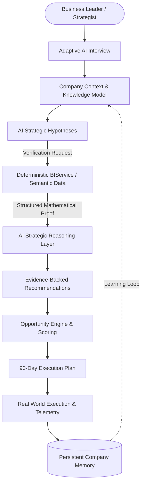

# AI Growth Strategy Studio + PowerGen BI
## Complete System Architecture, Modules & Features Guide

This document provides a comprehensive technical and functional catalog of all modules, engines, and features implemented across the **AI Growth Strategy Studio** and the **PowerGen BI Enterprise Production Engine**.

---

## Table of Contents
1. [System Architectural Overview](#1-system-architectural-overview)
2. [Module Map & Core Engines](#2-module-map--core-engines)
3. [Module 1: AI Growth Strategy Studio (Executive Reasoning Layer)](#3-module-1-ai-growth-strategy-studio-executive-reasoning-layer)
   - 3.1 [Strategic Briefing (Home)](#31-strategic-briefing-home)
   - 3.2 [Strategy Canvas ("What Should We Do?")](#32-strategy-canvas-what-should-we-do)
   - 3.3 [AI Strategic Hypotheses Engine](#33-ai-strategic-hypotheses-engine)
   - 3.4 [Strict Recommendation Engine](#34-strict-recommendation-engine)
   - 3.5 [Strategy Personas](#35-strategy-personas)
   - 3.6 [Adversarial Challenge Strategy Engine](#36-adversarial-challenge-strategy-engine)
4. [Module 2: AI Business Intelligence & Semantic Evidence Layer](#4-module-2-ai-business-intelligence--semantic-evidence-layer)
   - 4.1 [Intelligence Canvas ("What Is Happening and Why?")](#41-intelligence-canvas-what-is-happening-and-why)
   - 4.2 [Deterministic BI Calculations (`BIService`)](#42-deterministic-bi-calculations-biservice)
   - 4.3 ["Ask AI" Everywhere Contextual Actions](#43-ask-ai-everywhere-contextual-actions)
   - 4.4 [6-Dimension "Dig Deeper" Root-Cause Investigation](#44-6-dimension-dig-deeper-root-cause-investigation)
   - 4.5 [Ask Business Intelligence Query Engine](#45-ask-business-intelligence-query-engine)
   - 4.6 [AI BI → Strategy Bridge](#46-ai-bi--strategy-bridge)
   - 4.7 [Statistical Anomaly Detection](#47-statistical-anomaly-detection)
5. [Module 3: Discovery, Knowledge & Adaptive Question Engine](#5-module-3-discovery-knowledge--adaptive-question-engine)
   - 5.1 [Adaptive AI Strategy Interview](#51-adaptive-ai-strategy-interview)
   - 5.2 [Conceptual Question Engine](#52-conceptual-question-engine)
   - 5.3 [Company Understanding Model](#53-company-understanding-model)
   - 5.4 [Persistent Company Memory & Learning Loop](#54-persistent-company-memory--learning-loop)
6. [Module 4: Growth Execution & Scenario Modeling](#6-module-4-growth-execution--scenario-modeling)
   - 6.1 [Growth Opportunity Center](#61-growth-opportunity-center)
   - 6.2 [90-Day Strategic Execution Roadmap](#62-90-day-strategic-execution-roadmap)
   - 6.3 [Audience & Content Intelligence Views](#63-audience--content-intelligence-views)
   - 6.4 [What-If Scenario Simulator](#64-what-if-scenario-simulator)
   - 6.5 [19-Step Demo Story Tour](#65-19-step-demo-story-tour)
7. [Module 5: PowerGen BI Enterprise Production Engine (Classic Mode)](#7-module-5-powergen-bi-enterprise-production-engine-classic-mode)
   - 7.1 [Data Ingestion & Hygiene Pipeline](#71-data-ingestion--hygiene-pipeline)
   - 7.2 [Automated Dashboard Planner](#72-automated-dashboard-planner)
   - 7.3 [DAX Formula Studio & Copilot](#73-dax-formula-studio--copilot)
   - 7.4 [PBIR & Dual-Target Report Builder](#74-pbir--dual-target-report-builder)
   - 7.5 [Power BI Service & Microsoft Fabric Integration](#75-power-bi-service--microsoft-fabric-integration)
   - 7.6 [AI Analyst Conversational Copilot](#76-ai-analyst-conversational-copilot)
   - 7.7 [Multi-Dataset Benchmarking & Comparison](#77-multi-dataset-benchmarking--comparison)
8. [Backend Service Layer & Contracts](#8-backend-service-layer--contracts)
9. [Verification, Quality Assurance & Test Coverage](#9-verification-quality-assurance--test-coverage)

---

## 1. System Architectural Overview

The platform bridges **strategic business reasoning** and **deterministic data engineering**. Rather than forcing executives to decode raw charts or allowing AI to hallucinate business figures, the system enforces a strict two-way contract:

### The Primary Operating Loop
$$\text{Understand} \to \text{Ask} \to \text{Research} \to \text{Analyze} \to \text{Verify} \to \text{Explain} \to \text{Recommend} \to \text{Prioritize} \to \text{Act} \to \text{Measure} \to \text{Learn}$$

---

## 2. Module Map & Core Engines

| Layer | Module Name | Primary Role | Code Location |
| :--- | :--- | :--- | :--- |
| **Strategy** | **Growth Studio Orchestrator** | Coordinates 8-screen flow, personas, and modals | `frontend/src/growth-studio/GrowthStudioApp.jsx` |
| **Strategy** | **Strategic Briefing** | Morning briefing, 3 key things, recommended actions | `frontend/src/growth-studio/components/StrategicBriefingScreen.jsx` |
| **Strategy** | **Executive Strategy Canvas** | Answers *"What should we do?"*, hypotheses, risks | `frontend/src/growth-studio/components/ExecutiveStrategyScreen.jsx` |
| **Strategy** | **Adversarial Review** | `Challenge Strategy`: stress-tests assumptions & risks | `frontend/src/growth-studio/components/ChallengeStrategyModal.jsx` |
| **Intelligence** | **AI BI Semantic Canvas** | Answers *"What is happening & why?"*, telemetry | `frontend/src/growth-studio/components/IntelligenceScreen.jsx` |
| **Intelligence** | **Deterministic BI Service** | Ground-truth calculations, cohorts, anomalies | `frontend/src/growth-studio/services/BIService.js` |
| **Intelligence** | **AI Reasoning Service** | Hypotheses, explanations, recommendations, 6-dim audits | `frontend/src/growth-studio/services/AIService.js` |
| **Knowledge** | **Company Knowledge & Memory** | Confidence radar, historical decisions & outcomes | `frontend/src/growth-studio/components/CompanyKnowledgeScreen.jsx` |
| **Knowledge** | **Adaptive Interview Engine** | Contextual follow-up questioning with "Why we're asking" | `frontend/src/growth-studio/components/AdaptiveInterviewScreen.jsx` |
| **Execution** | **Opportunity Center** | Impact/Effort scoring, P1/P2/P3 prioritization | `frontend/src/growth-studio/components/OpportunityCenterScreen.jsx` |
| **Execution** | **90-Day Execution Plan** | Phase 1/2/3 roadmaps, task statuses, strategic rationale | `frontend/src/growth-studio/components/ActionPlanScreen.jsx` |
| **Execution** | **What-If Scenario Simulator** | Financial & lead projection model with assumptions | `frontend/src/growth-studio/components/WhatIfScenarioModal.jsx` |
| **Execution** | **19-Step Demo Walkthrough** | Interactive step-by-step verification of full demo story | `frontend/src/growth-studio/components/DemoStoryTourModal.jsx` |
| **Classic BI** | **Data Ingestion Pipeline** | CSV/XLSX validation, cleaning, profiling (200k rows) | `backend/app/data/`, `frontend/src/components/UploadSection.jsx` |
| **Classic BI** | **DAX Studio & Copilot** | Formula generation, syntax validation, explanations | `backend/app/analytics/dax_copilot.py`, `frontend/src/components/DaxStudio.jsx` |
| **Classic BI** | **PBIR Solution Builder** | Standards-compliant Power BI Enhanced Report bundles | `backend/app/powerbi/report_builder.py`, `frontend/src/components/GenerationResult.jsx` |
| **Classic BI** | **Conversational Copilot** | Deterministic tool execution & visual pinning | `frontend/src/components/AIChat.jsx`, `backend/app/api/v1/agent.py` |

---

## 3. Module 1: AI Growth Strategy Studio (Executive Reasoning Layer)

### 3.1 Strategic Briefing (Home)
- **File:** `frontend/src/growth-studio/components/StrategicBriefingScreen.jsx`
- **Concept:** Replaces traditional static admin dashboards with an executive morning intelligence briefing.
- **Key Features:**
  - **Greeting & Focus Banner:** *"Good morning. Here is what matters right now."* Displays company name and current anchor objective (e.g., *Generate qualified enterprise leads*).
  - **3 Things You Should Know:** Verified synthesis cards highlighting expanding enterprise value, content conversion mismatches, and AI answer engine visibility deficits.
  - **Recommended Actions:** High-priority cards adhering strictly to the *Why* and *Evidence* principle with direct execution links.
  - **Internal Analytical Health Indicators:** Radar overview covering Audience Fit, Search Visibility, Content Strength, AI Discoverability, Conversion Readiness, and Competitive Position.

### 3.2 Strategy Canvas ("What Should We Do?")
- **File:** `frontend/src/growth-studio/components/ExecutiveStrategyScreen.jsx`
- **Concept:** Dedicated workspace for strategic reasoning, long-term positioning, and prioritized interventions.
- **Key Features:**
  - Executive summary and current-state health audit.
  - Mode badge differentiating the **STRATEGY** reasoning layer from the **INTELLIGENCE** analytical layer.
  - Direct integration into the 90-Day Action Plan and Opportunity Center.

### 3.3 AI Strategic Hypotheses Engine
- **Concept:** The AI is strictly prohibited from immediately turning raw observations into final business recommendations. It must first structure observations as hypotheses awaiting verification.
- **Key Features:**
  - Formulates explicit hypothesis statements (e.g., *"Enterprise customers may represent the company's highest-growth revenue opportunity."*).
  - Tracks initial confidence levels and lists currently available observations.
  - **"Verify with BI" Trigger:** Sends a structured analytical request to `BIService.compareSegments()` or `BIService.getContentPerformance()`.
  - **Verification Modal:** Displays mathematical proof returned by the BI layer, calculates verification confidence, and allows instant promotion to an active recommendation.

### 3.4 Strict Recommendation Engine
- **Core Principle:** Never allow AI to make a business recommendation without demonstrating why.
- **Enforced Structure:**
  $$\text{Recommendation} \to \text{Why} \to \text{Evidence} \to \text{Confidence} \to \text{Recommended Action}$$
- **Example In-App Record:**
  - **Recommendation:** *Focus all primary website and outbound growth resources on Enterprise customers.*
  - **Why:** *Enterprise accounts represent only 18% of total web traffic but generate 42% of total pipeline revenue.*
  - **Evidence:** *Conversion rate: 8.7% baseline; Average deal size: $78,500; Pipeline share: 42%; Coverage: Low.*
  - **Confidence:** *88% verified confidence.*
  - **Recommended Action:** *Build dedicated enterprise solution pages and restore consultative VIP demo paths.*

### 3.5 Strategy Personas
- **Concept:** Allows users to view the identical underlying dataset through different organizational lenses without mutating ground truth.
- **Supported Personas:**
  1. **Founder:** Focuses on enterprise contract value, payback periods, and capital efficiency.
  2. **CMO:** Focuses on total market reach, brand citations, and acquisition channels.
  3. **Growth Strategist:** Focuses on conversion funnels, landing page optimization, and experiment velocity.
  4. **SEO Strategist:** Focuses on organic search, topical authority, and Generative Engine Optimization (GEO).
  5. **Product Marketer:** Focuses on buyer packaging, ICP objections, and positioning moats.
  6. **Analyst:** Focuses on statistical confidence, cohort retention, and verified BI metrics.

### 3.6 Adversarial Challenge Strategy Engine
- **File:** `frontend/src/growth-studio/components/ChallengeStrategyModal.jsx`
- **Concept:** Prevents the AI from blindly agreeing with its own proposals by launching an intentional adversarial stress-test.
- **Key Features:**
  - **Counterarguments:** Identifies acute risks (e.g., *74-day enterprise sales cycle cashflow lag*, *revenue concentration in few contracts*, *missing self-serve volume*).
  - **Confidence Evidence Requirements:** Answers *"What evidence would increase confidence?"* (e.g., *6 months of cohort churn data*, *segment CAC payback metrics*).
  - **Strategic Hedge:** Proposes dual-track mitigations to protect near-term cashflow.

---

## 4. Module 2: AI Business Intelligence & Semantic Evidence Layer

### 4.1 Intelligence Canvas ("What Is Happening and Why?")
- **File:** `frontend/src/growth-studio/components/IntelligenceScreen.jsx`
- **Concept:** Operational telemetry layer where metrics are computed deterministically and interpreted via AI reasoning.
- **Key Features:**
  - Real-time business KPIs (Organic Traffic, Conversion Rate, Qualified Leads, Pipeline Value, Average Deal Size, Blended CAC).
  - Trend badges, variance indicators, and anomaly alerts.

### 4.2 Deterministic BI Calculations (`BIService`)
- **File:** `frontend/src/growth-studio/services/BIService.js`
- **Enforced Separation:** Data calculation is isolated from AI interpretation. The AI consumes structured JSON results.
- **Core Methods:**
  - `getMetric(key)`: Returns mathematically accurate summary metrics.
  - `compareSegments(dimension, segments)`: Computes traffic share, conversion rates, deal values, and revenue contribution across Enterprise, Mid-Market, and SMB cohorts.
  - `analyzeTrend(key, timeframe)`: Period-over-period delta calculations.
  - `findAnomalies()`: Scans datasets for statistical deviations.
  - `runScenario(base, params)`: Runs deterministic financial & lead projections.
  - `getContentPerformance()`: Computes commercial vs. informational traffic and lead distribution.
  - `getConversionData()`: Multi-dimensional conversion matrix.

### 4.3 "Ask AI" Everywhere Contextual Actions
Every metric card and visual element provides 3 contextual AI actions:
1. `[Explain]`: Generates a natural language narrative detailing underlying drivers.
2. `[Dig Deeper]`: Launches a root-cause investigation across 6 analytical dimensions.
3. `[Add to Strategy]`: Transfers the insight into the strategic reasoning layer.

### 4.4 6-Dimension "Dig Deeper" Root-Cause Investigation
- **Trigger:** Metric volatility or anomalies (e.g., *Enterprise conversion dropped 29.8%*).
- **Audit Dimensions:**
  1. **By Audience:** Segment breakdown isolating the exact cohort experiencing decline.
  2. **By Channel:** Paid vs. Organic vs. Direct vs. Referral performance.
  3. **By Page:** URL-level conversion and bounce rate analysis.
  4. **By Geography:** Regional variance (North America vs. Europe vs. APAC).
  5. **By Device:** Desktop enterprise workstation vs. mobile behavior.
  6. **Over Time:** Correlation with specific deployment dates and marketing sprints.
- **Output:** Returns **Likely Cause**, **Supporting Evidence**, **Possible Reason**, **Recommended Action**, and **Confidence Level**.

### 4.5 Ask Business Intelligence Query Engine
- **Pre-configured Queries:**
  - *"What changed in the last 30 days?"*
  - *"Which audience is driving growth?"*
  - *"Which channel performs best?"*
  - *"What is our biggest weakness?"*
- **Structured Response Format:**
  1. Executive Answer
  2. Supporting BI Metric
  3. Relevant Comparison
  4. Analytical Explanation
  5. Recommended Next Action
  6. `[Add Insight to Strategy]` Button

### 4.6 AI BI → Strategy Bridge
- **Concept:** Connects analytical discovery to strategic decision-making.
- **Workflow:** Clicking `[Add Insight to Strategy]` transforms a BI data finding into a strategy hypothesis, registers it with `CompanyMemory`, and updates the executive strategic priority list.

### 4.7 Statistical Anomaly Detection
- Scans for divergence between volume and commercial efficiency (e.g., informational blog traffic up +28.5% while commercial landing page traffic fell -1.4%).
- Flags Generative Engine Optimization (GEO) gaps where AI answer engines cite competitors over the user's domain.

---

## 5. Module 3: Discovery, Knowledge & Adaptive Question Engine

### 5.1 Adaptive AI Strategy Interview
- **File:** `frontend/src/growth-studio/components/AdaptiveInterviewScreen.jsx`
- **Concept:** Replaces long, static 30-field onboarding forms with an adaptive, conversational question engine.
- **Key Features:**
  - Begins with 6 foundational questions (Company Model, Products, Customers, Growth Goal, Geography, Moat).
  - Dynamically detects topics in user responses to spawn contextual follow-ups (e.g., mentioning *Enterprise* triggers questions about dedicated VPC tiers, custom SLAs, and sales objections).
  - Users can answer, edit, or skip questions at any time.

### 5.2 Conceptual Question Engine
- **Architecture:** Every question is structured as a typed schema:
  - `question`: Precise inquiry.
  - `reason`: **"Why we're asking this"** callout explaining strategic relevance.
  - `category`: Business, Audience, Product, Competition, Market, Website, Content, Sales, Conversion, Growth.
  - `importance`: Critical, High, Medium.
  - `confidence`: Mathematical confidence contribution.
  - `source`: Foundation Protocol vs. Adaptive Reasoning Engine.

### 5.3 Company Understanding Model
- **File:** `frontend/src/growth-studio/components/CompanyKnowledgeScreen.jsx`
- **Confidence Radar:** Tracks and visualizes confidence across 6 strategic pillars:
  - **Business Model:** 94% (Strong)
  - **Products & Offerings:** 91% (Strong)
  - **Audience & Segments:** 74% (Moderate)
  - **Competition & Positioning:** 61% (Moderate)
  - **Customer Motivation & Objections:** 48% (Weak)
  - **Digital Presence & AEO:** 66% (Moderate)
- **"Help AI understand this" Action:** When an area falls below 50% confidence, the system flags the gap and provides a 1-click prompt to gather targeted knowledge.

### 5.4 Persistent Company Memory & Learning Loop
- **File:** `frontend/src/growth-studio/services/CompanyMemoryService.js`
- **Concept:** Ensures the AI retains context across sessions and actively learns from past business experiments.
- **Stored Structures:**
  - **Facts:** Company name, business model, offerings, core differentiators.
  - **Goals:** Active pipeline targets, search objectives.
  - **Assumptions:** Validated vs. refuted market hypotheses.
  - **Recorded Decisions:** Strategic choices made by the executive team.
  - **Observed Outcomes:** Subsequent metric changes measured by BI.
  - **Synthesized Results & Learned Takeaways:**
    $$\text{Previous Decision} \to \text{Observed Outcome} \to \text{Synthesized Result} \to \text{New Learned Recommendation}$$
  - *Example in Memory:* Decision to prioritize enterprise led to +27% traffic but flat conversion $\to$ AI learns that the new bottleneck is conversion friction rather than traffic acquisition.

---

## 6. Module 4: Growth Execution & Scenario Modeling

### 6.1 Growth Opportunity Center
- **File:** `frontend/src/growth-studio/components/OpportunityCenterScreen.jsx`
- **Scored Attributes:**
  - Title, Category, Impact (0–100), Effort (0–100), Confidence (0–100), Business Relevance, Audience Relevance.
  - Grounded Evidence and Strategic Rationale.
- **Interactive Actions:**
  - `[Explore]`: Opens detailed modal with implementation steps.
  - `[Verify with BI]`: Re-checks supporting metrics against current BI data.
  - `[Add to Plan]`: Promotes the initiative directly into the 90-day execution roadmap.

### 6.2 90-Day Strategic Execution Roadmap
- **File:** `frontend/src/growth-studio/components/ActionPlanScreen.jsx`
- **Phase Breakdown:**
  - **Month 1 — Foundation (P1 Critical):** High-leverage fixes (e.g., dedicated enterprise solution page, restoring consultative VIP demo CTAs).
  - **Month 2 — Authority & Scaling (P2 High):** Generative Engine Optimization (GEO), schema markup, competitor comparison matrices.
  - **Month 3 — Expansion (P3 Medium):** Reverse-IP account personalization, benchmark reports, ecosystem co-marketing.
- **Task Management:** Real-time status toggling (`todo`, `in_progress`, `completed`), effort sizing, and impact attribution.

### 6.3 Audience & Content Intelligence Views
- **Audience Intelligence:** Cohort breakdowns, deal velocity, sales cycle lengths, and churn risk.
- **Content Intelligence:** Topical authority audits, commercial vs. informational performance ratios, search cluster gaps.

### 6.4 What-If Scenario Simulator
- **File:** `frontend/src/growth-studio/components/WhatIfScenarioModal.jsx`
- **Concept:** Deterministic financial modeling simulating the impact of traffic growth, conversion rate improvements, and enterprise prioritization.
- **Key Features:**
  - Real-time parameter sliders (Traffic $\Delta\%$, Conversion Rate $\Delta\%$, Enterprise Focus toggle).
  - Current vs. Scenario side-by-side comparison (Visitors, Leads, Pipeline Valuation, Average Deal Size).
  - **Explicit Assumptions Banner:** Clearly labels all estimates as modeled projections rather than guaranteed results.

### 6.5 19-Step Demo Story Tour
- **File:** `frontend/src/growth-studio/components/DemoStoryTourModal.jsx`
- **Concept:** An interactive, self-guided walkthrough that executes and demonstrates the end-to-end 19-step customer journey:
  1. Enters company profile.
  2. Selects "Generate Leads" goal.
  3. AI asks adaptive follow-ups.
  4. User provides context.
  5. AI identifies Customer Motivation knowledge gap.
  6. AI generates enterprise growth hypothesis.
  7. User clicks "Verify with BI".
  8. BI returns segment evidence.
  9. AI explains evidence narrative.
  10. AI creates high-impact opportunity.
  11. User clicks "Add to Strategy".
  12. AI updates strategic recommendations.
  13. User opens 90-day plan.
  14. User adjusts What-If scenario.
  15. AI explains projected impact with assumptions.
  16. User asks "Why did conversion drop?".
  17. AI returns 6-dimension root-cause audit.
  18. User clicks "Challenge Strategy".
  19. AI presents counterarguments and required confidence evidence.

---

## 7. Module 5: PowerGen BI Enterprise Production Engine (Classic Mode)

Accessible at any time via the **"Classic BI"** button in the header for raw dataset workflows and Power BI Desktop / Fabric generation.

### 7.1 Data Ingestion & Hygiene Pipeline
- **Backend Files:** `backend/app/data/cleaner.py`, `backend/app/data/inspector.py`, `backend/app/data/validator.py`
- **Frontend Files:** `frontend/src/components/UploadSection.jsx`, `frontend/src/components/DatasetProfiler.jsx`
- **Capabilities:**
  - High-throughput CSV/XLSX parsing tested against 200,000+ marketing campaign records.
  - Multi-stage hygiene: whitespace normalization, currency/percentage parsing, missing value imputation.
  - Anomaly detection: z-score statistical profiling on spend, ROI, and conversion rates.

### 7.2 Automated Dashboard Planner
- **Backend File:** `backend/app/powerbi/planner.py`
- **Frontend File:** `frontend/src/components/PlanReviewer.jsx`
- **Capabilities:**
  - Formulates structured dashboard blueprints with layout specifications, visual types, metric allocations, and filter configurations.
  - Strictly validated via Pydantic contract schemas before rendering.

### 7.3 DAX Formula Studio & Copilot
- **Backend File:** `backend/app/analytics/dax_copilot.py`
- **Frontend File:** `frontend/src/components/DaxStudio.jsx`
- **Capabilities:**
  - Generates optimized DAX measures (`CALCULATE`, `DIVIDE`, `SUMX`, time intelligence).
  - Evaluates formula syntax validity, explains business logic, and offers 1-click addition to dashboard plans.

### 7.4 PBIR & Dual-Target Report Builder
- **Backend File:** `backend/app/powerbi/report_builder.py`
- **Frontend File:** `frontend/src/components/GenerationResult.jsx`
- **Capabilities:**
  - Compiles valid Power BI Enhanced Report Definition (`.pbir`) file bundles.
  - Dual-target compilation: generates standalone local bundles for Power BI Desktop alongside direct Fabric/Service REST API payloads.

### 7.5 Power BI Service & Microsoft Fabric Integration
- **Backend Files:** `backend/app/powerbi/service.py`, `backend/app/api/v1/powerbi.py`
- **Capabilities:**
  - OAuth2 and Service Principal credential handling with zero credential leakage.
  - Automated workspace deployment, semantic model creation, and report binding.
  - Graceful decoupled fallback when operating in offline or local mode.

### 7.6 AI Analyst Conversational Copilot
- **Frontend File:** `frontend/src/components/AIChat.jsx`
- **Backend File:** `backend/app/api/v1/agent.py`
- **Capabilities:**
  - Natural language querying against dataset records.
  - Tool-calling agent execution (queries data without fabricating metrics).
  - Pinned visuals: allows users to pin conversational charts directly onto their dashboard plan.

### 7.7 Multi-Dataset Benchmarking & Comparison
- **Frontend File:** `frontend/src/components/DatasetComparator.jsx`
- **Capabilities:**
  - Upload and benchmark secondary campaign datasets against baseline performance.
  - Channel-by-channel variance analysis and cohort drift visualization.

---

## 8. Backend Service Layer & Contracts

### REST API Endpoints

| Method | Route | Description | Pydantic Contract |
| :--- | :--- | :--- | :--- |
| `GET` | `/health` | System health, Ollama status, Groq availability | `HealthResponse` |
| `POST` | `/api/v1/dataset/upload` | Validates, cleans, and profiles dataset | `DatasetUploadResponse` |
| `POST` | `/api/v1/dataset/analyze` | Generates statistical metrics and anomalies | `AnalyticsResponse` |
| `POST` | `/api/v1/plan/generate` | Generates structured dashboard plan | `DashboardPlan` |
| `POST` | `/api/v1/powerbi/generate-pbir` | Compiles `.pbir` project bundle | `PBIRGenerationResponse` |
| `POST` | `/api/v1/powerbi/build-solution` | Dual-target local + service bundle builder | `BISolutionResponse` |
| `POST` | `/api/v1/powerbi/publish` | Publishes report to Power BI Service / Fabric | `PublishResponse` |
| `POST` | `/api/v1/agent/chat` | AI Analyst tool-calling execution | `AgentChatResponse` |
| `POST` | `/api/v1/agent/dax-copilot` | DAX generation, validation, and explanation | `DAXCopilotResponse` |

---

## 9. Verification, Quality Assurance & Test Coverage

### Test Results
The backend test suite verifies all deterministic analytics, contract schemas, and orchestration tools:

$$\mathbf{160\ Tests\ Executed\ \bullet\ 160\ Passed\ (100\%\ Pass\ Rate)\ \bullet\ 25.68s}$$

### Verified Test Suites
- `test_agent_orchestrator.py`: Tool registry and intent classification.
- `test_agentic_bi_platform.py`: End-to-end orchestration pipeline.
- `test_analytics.py`: Deterministic marketing calculations (ROI, CAC, conversion).
- `test_api_agent.py` & `test_api_dataset.py`: FastAPI route contracts.
- `test_bi_solution_builder.py`: Dual-target solution generation.
- `test_cleaner.py` & `test_inspector.py`: Data type validation and anomaly profiling.
- `test_dashboard_planner.py`: Pydantic layout schema validation.
- `test_dax_copilot.py` & `test_dax_validator.py`: DAX measure generation and syntax checks.
- `test_powerbi_report_builder.py` & `test_powerbi_project.py`: PBIR standards compliance.
- `test_powerbi_service.py`: Power BI Service adapter and decoupled fallback.
- `test_visualization_selector.py`: Best-practice visual recommendation heuristics.

### Frontend Compilation
- Build tool: Vite v8.3.0 with React 19.
- Status: Production build compiles in 383ms with 0 errors.
- Active HTTP server: Serving locally on `http://localhost:3000` (`HTTP 200 OK`).
